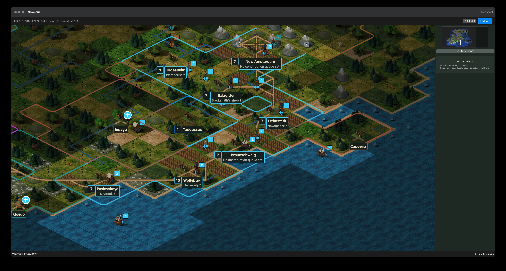
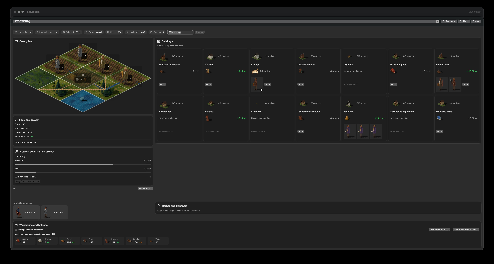

# Novaloria

**Novaloria** is a native macOS client built with SwiftUI for [FreeCol](https://www.freecol.org), the turn-based strategy game. It connects to a Java FreeCol server over the FreeCol TCP/XML protocol.

> **Language:** The interface is localized in German, English and Spanish. Choose a language on the startup screen or in-game preferences, or follow macOS's system language (unsupported system languages fall back to English).

Novaloria is an independent community project and is not officially affiliated with the FreeCol project.

## Features

- Connect to a running FreeCol server
- Create local Java games and load savegames
- Explore an illustrated game map with terrain, units, colonies and territory borders
- Manage colony workers, production, construction, warehouses and harbor transport
- Visit native settlements and review diplomacy, trade, reports and game messages
- Save games through the Java server (with an optional server extension)
- Swift protocol CLI for protocol testing and diagnostics

See the [build and operation guide](Docs/build_and_run.md) for details and known limitations (currently available in German). The German README is [README_DE.md](README_DE.md).

See the [v0.0.3 release notes](Docs/releases/0.0.3.md) for the latest changes.

## Screenshots

### World map



### Colony management



## Using the Novaloria Atlas mod

1. Download [`NovaloriaAtlas.zip`](Mods/NovaloriaAtlas.zip) and place it in your FreeCol installation's `data/mods/` folder or in `~/Library/Application Support/freecol/mods/`.
2. In Novaloria, open **Mods** and select the FreeCol installation folder containing `FreeCol.jar` and `data/`.
3. Enable **Novaloria Atlas**.

The Atlas replaces artwork for the map, units, settlements, goods, and Colopedia. Rule-changing mods affect new local games; when connected to a server, the server determines the game rules. See [`Mods/README.md`](Mods/README.md) for details.

## Requirements

- macOS 14 or later
- Xcode or Swift 5.9 or later
- For local Java games: a compatible FreeCol installation and Java version

A local Java installation is not required to connect to a server.

## Download

Download the prebuilt macOS DMG from [GitHub Releases](https://github.com/kubus7679/Novaloria/releases/latest). You do not need to compile Novaloria yourself to use the app.

## Build and run

Building from source is only necessary if you want to develop Novaloria or build it yourself:

```bash
swift build --target Novaloria
swift run Novaloria
```

Create a macOS app bundle with:

```bash
bash Tools/build-app.sh
```

For game setup, controls, tests and Java server integration, see [`Docs/build_and_run.md`](Docs/build_and_run.md).

## Tests

```bash
swift test
```

Some Java server end-to-end tests additionally require a local FreeCol installation or Docker. See the build and operation guide.

## License and resource attributions

The source code is distributed under the **GNU General Public License, version 2 only (GPL-2.0-only)**. See [`LICENSE`](LICENSE).

The repository also contains graphics and content derived from FreeCol data. Their origins and license notices are listed in [`THIRD_PARTY_NOTICES.md`](THIRD_PARTY_NOTICES.md); the included FreeCol license is also available at `Sources/Novaloria/Resources/FreeCol-COPYING`.
